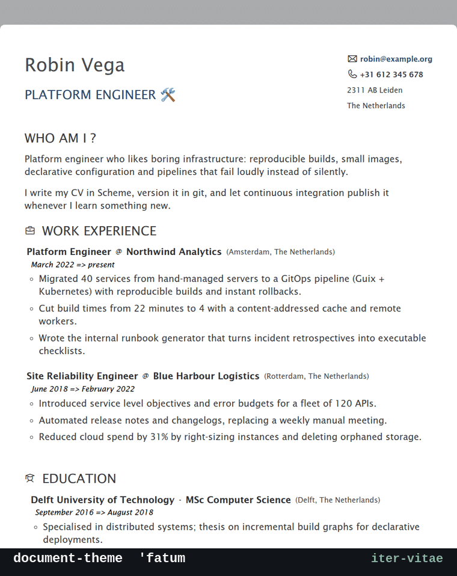

#+title: Iter Vitae
#+subtitle: Write your CV as Scheme code, publish it as a document you are proud of
#+author: Josep Bigorra
#+email: jjbigorra@gmail.com
#+language: en
#+options: toc:nil num:nil
#+html_head: <meta name="description" content="Iter Vitae generates an attractive, modern, multilingual CV or resume from a Guile Scheme file: HTML for humans, plain text for applicant tracking systems." />

[[https://jointhefreeworld.org/ggg/dist/scheme-guile.svg]] [[https://jointhefreeworld.org/ggg/dist/gnu-guix.svg]] [[https://jointhefreeworld.org/ggg/dist/maak.svg]] [[https://jointhefreeworld.org/ggg/dist/veritas.svg]] [[https://jointhefreeworld.org/ggg/dist/codeberg.svg]]
[[https://img.shields.io/badge/release-1.0.2-blue.svg]] [[https://img.shields.io/badge/Guix-channel-6f4e9c.svg]] [[https://jointhefreeworld.org/ggg/dist/license-agpl3+.svg]] [[https://jointhefreeworld.org/ggg/dist/license-fdl13+.svg]]

*Iter Vitae* — Latin for “the journey of a life” — turns a single Guile Scheme
file into a modern, multilingual /Curriculum Vitae/: ~index.html~ for humans,
~resume.txt~ for the robots.

You describe your jobs, your studies, your languages and your interests as
ordinary Scheme data. Iter Vitae renders that data through the theme you pick,
in the language you ask for, and writes a document you can print, host or
e-mail. No word processor, no dragging of text boxes, no proprietary file
format: just a text file you can put in git and diff like the rest of your work.

It is free software (AGPL-3.0-or-later), it runs offline, and it is built to
serve you for the next forty years.

#+begin_quote
Everyone has the right to create a professional-looking CV with free software —
without proprietary licenses, lengthy setup, or a layout they are not allowed
to change.
#+end_quote

If Iter Vitae saves you an afternoon, consider [[https://bmc.link/jjbigorra][buying me a cup of coffee ☕]] so
I can keep going with a lot of motivation. Changelog and release notes live in
[[file:NEWS.org][NEWS.org]].

* See it in action
:PROPERTIES:
:CUSTOM_ID: demo
:END:

#+attr_html: :width 760px :alt Animated tour: the same CV rendered in the fatum, ef-cyprus, fundamental and ats themes

/Four themes, one persona. The same Scheme file (~populus/vega.scm~) rendered
with =fatum=, =ef-cyprus=, =fundamental= and =ats=; only the =document-theme=
symbol changes./

And here is a real one, published straight from the repository:
[[https://jointhefreeworld.org/joe-cv/][the author's CV, generated with Iter Vitae]] (also in
[[https://jointhefreeworld.org/joe-cv/nl/][Dutch]] and [[https://jointhefreeworld.org/joe-cv/es/][Spanish]]).

* Why you will like it
:PROPERTIES:
:CUSTOM_ID: features
:END:

- *Your CV is data, not a document.* Iter Vitae follows a
  model–view–controller split: your persona file is the model, the theme is the
  view. Change your job without touching a single style; change your style
  without touching a single line of content.
- *One source, several themes.* Switch =document-theme= from ='fatum= to
  ='ef-cyprus= to ='fundamental= to ='ats= and re-render. The content stays;
  the presentation changes completely.
- *Multilingual by design.* Every piece of prose is a translation alist, so one
  file holds all your languages: ~en~, ~nl~, ~es~, ~de~, ~ca~, whatever you
  speak. Render one document per locale from the same source.
- *Beautiful, modern output.* Static HTML with inlined CSS, bundled
  [[https://codeberg.org/jjba23/olive-css][Olive CSS]], real typography and no JavaScript. Open it from disk, print it to
  PDF, or serve it anywhere.
- *Plain text for applicant tracking systems.* ~--format text~ writes a
  ~resume.txt~ with conventional headings, one item per line, ~-~ bullets and no
  markup — for employers that only accept a text box. The =ats= theme does the
  same clean-up in HTML.
- *Designed for the long run.* Forty years of career means forty years of
  edits. Version-control your CV, branch it for a specific application, and
  keep the history of who you were when.
- *Lisp all the way down.* Everything is extensible: define helpers that build
  job entries, loop over a list of talks, compute dates, generate bullets from
  an Org file. Guile Scheme is the configuration language, so the configuration
  language is a programming language.
- *Reproducible toolchain.* Guix, Nix, a container or a distro package — the
  same sources and the same result, with the ability to roll back a bad
  upgrade. The build never fails with “it worked on my machine”.
- *Free software, no strings.* No account, no telemetry, no network call from
  the program itself. The AGPL keeps the tool free for everyone who uses it.
- *Warm and welcoming.* Themes, translations, documentation and bug reports are
  all contributions. See [[#iter-vitae-project][Contributing]]; you are invited.

* Quick start
:PROPERTIES:
:CUSTOM_ID: quick-start
:END:

/From nothing to a CV in your browser in about a minute./

** 1. Install it

With a checkout of the [[https://codeberg.org/jjba23/guix-jointhefreeworld][jointhefreeworld Guix channel]] — no channel
configuration needed:

#+begin_src shell
git clone https://codeberg.org/jjba23/guix-jointhefreeworld.git
guix install -L ./guix-jointhefreeworld iter-vitae
#+end_src

Using Nix instead? Run it without installing anything:

#+begin_src shell
nix run git+https://codeberg.org/jjba23/nix-jointhefreeworld#iter-vitae -- --help
#+end_src

Every other route is documented in [[#installing][Installation]].

** 2. Write your CV

Save this as ~my-cv.scm~. The module name matters: Iter Vitae loads your file
as the module ~(iter-vitae persona)~.

#+begin_src scheme
;;; my-cv.scm — a minimal Iter Vitae persona
(define-module (iter-vitae persona)
  #:declarative? #t)

(define document-theme 'ef-cyprus)

(define display-name
  `((all . "Ada Example")))

(define job-title
  `((en . "Software Engineer")
    (nl . "Softwareontwikkelaar")))

(define personal-contact
  `((emails . "ada@example.org")
    (phone-numbers . "+31 612 345 678")))

(define short-intro
  `(((en . "I build small tools that respect their users.")
     (nl . "Ik bouw kleine tools die hun gebruikers respecteren."))))

(define education
  `(((name (all . "University of Example"))
     (location (all . "Leiden, The Netherlands"))
     (position (en . "MSc Computer Science"))
     (time (en . "September 2018 => August 2020"))
     (experience ((en . "Thesis on reproducible builds and boring infrastructure."))))))

(define jobs
  `(((name (all . "Example B.V."))
     (location (all . "Amsterdam, The Netherlands"))
     (position (en . "Software Engineer"))
     (time (en . "September 2020 => present"))
     (experience ((en . "Shipped software that people actually use."))
                 ((en . "Deletes more code than writes."))))))
#+end_src

Only ~display-name~ and ~job-title~ are required. Leave a field out and it is
simply empty.

** 3. Render it

#+begin_src shell
iter-vitae --file my-cv.scm --destination dist
xdg-open dist/index.html          # or: firefox dist/index.html
#+end_src

Want it in Dutch? Ask for the Dutch locale:

#+begin_src shell
iter-vitae --locale nl --file my-cv.scm --destination dist
#+end_src

Want plain text for an application form?

#+begin_src shell
iter-vitae --format text --file my-cv.scm --destination dist
cat dist/resume.txt
#+end_src

That is the whole loop: edit Scheme, re-render, look at the browser, commit.

* Installation
:PROPERTIES:
:CUSTOM_ID: installing
:END:

Iter Vitae is officially distributed through the Guix package manager and as
container images, but you are welcome to use it however you like, within the
terms of the GNU Affero General Public License v3 or newer.

/Four routes lead to the same 1.0.2, from the most automated to the most
manual. They all build the release tag this README documents./

** What you need
:PROPERTIES:
:CUSTOM_ID: requirements
:END:

To run Iter Vitae:

- *Guile Scheme 3.0* — the whole program is written in the GNU extension
  language, and this is its only real dependency. The SXML modules it uses for
  rendering are part of Guile itself.
- *Bash, coreutils and util-linux* — the ~iter-vitae~ launcher is a small Bash
  wrapper around the Guile program; it resolves paths with ~readlink~ and
  ~realpath~, and parses options with ~getopt~.
- *A web browser* — ideally one that can print to PDF, such as GNU IceCat or
  Firefox.
- *No network* — rendering is entirely local. The =fatum= and =ef-cyprus=
  themes do load web fonts and icon fonts from the network /when the page is
  opened/, so use =fundamental= or =ats= on an air-gapped machine, or host
  those fonts yourself.

To hack on Iter Vitae you additionally want [[https://codeberg.org/jjba23/maak][Maak]] (the task runner), [[https://codeberg.org/jjba23/veritas][Veritas]] (the test
framework) and ~guile-documenta~ (the API documentation generator). All of them
are in ~manifest.scm~. See [[#testing][Testing and development]].

** From the Guix channel
:PROPERTIES:
:CUSTOM_ID: from-the-guix-channel
:END:

*GNU Guix* is the functional package manager this project is developed with: a
build is a pure function of its inputs, so the same recipe gives the same
result everywhere, and an upgrade that goes wrong can be rolled back.

The jointhefreeworld channel carries ~iter-vitae~ at 1.0.2, so a checkout of
the channel is enough — no package definition to write:

#+begin_src shell
git clone https://codeberg.org/jjba23/guix-jointhefreeworld.git
guix install -L ./guix-jointhefreeworld iter-vitae
#+end_src

To make ~guix install iter-vitae~ keep working after every later ~guix pull~,
add the channel to ~$HOME/.config/guix/channels.scm~ once:

#+begin_src scheme
;; ~/.config/guix/channels.scm
(cons* (channel
        (name 'jointhefreeworld)
        (url "https://codeberg.org/jjba23/guix-jointhefreeworld")
        (branch "trunk")
        (introduction
         (make-channel-introduction
          "b0ac3f05075d7959860fc9e1db5871acddea3986"
          (openpgp-fingerprint
           "83BC 6E1C 8726 B8C2 97F8  D16E 24F4 6738 CE11 4AF6"))))
       %default-channels)
#+end_src

The ~introduction~ is the root of trust: it names the first signed commit and
the key that signed it, so Guix can verify every commit that follows. Keep it.

#+begin_src shell
guix pull
guix install iter-vitae
iter-vitae --help
#+end_src

** From the Nix flake
:PROPERTIES:
:CUSTOM_ID: from-the-nix-flake
:END:

*Nix* offers the same declarative, reproducible model with its own language,
its own store and a binary cache, and it is a natural fit if the rest of your
machine is already described in Nix.

The jointhefreeworld flake builds this project with this repository's own
expression, so the package cannot drift from the source:

#+begin_src shell
nix build github:jjba23/nix-jointhefreeworld#iter-vitae
./result/bin/iter-vitae --help

# or, without keeping the build result around:
nix run git+https://codeberg.org/jjba23/nix-jointhefreeworld#iter-vitae -- --help
#+end_src

The same attribute is available as an overlay, so
~pkgs.jointhefreeworld.iter-vitae~ works inside a NixOS or home-manager
configuration too.

This repository also has its own ~flake.nix~ (pinned to ~nixpkgs-unstable~),
which is handy while hacking:

#+begin_src shell
nix build .#iter-vitae        # flake
nix run .#iter-vitae -- --help
nix-build default.nix         # legacy nix-build
./result/bin/iter-vitae --help
#+end_src

Flakes are still behind a flag in some Nix versions; if ~nix build~ complains,
enable them in ~nix.conf~:

#+begin_src conf
experimental-features = nix-command flakes
#+end_src

** As a container image
:PROPERTIES:
:CUSTOM_ID: as-a-container-image
:END:

*Podman or Docker* is the route that puts nothing on the host: the ~Dockerfile~
in this repository builds the project in a builder stage and copies only what
it installed into a runtime stage, so the image is small and the host keeps its
own toolchain untouched.

Build it yourself and mount the directory that holds your CV:

#+begin_src shell
podman build -t iter-vitae .    # docker build -t iter-vitae . also works

podman run --rm -it --userns=keep-id \
    -v "$PWD:/work:Z" iter-vitae:latest \
    --file /work/my-cv.scm --destination /work/dist
#+end_src

With Docker, drop ~--userns=keep-id~ and pass ~-u "$(id -u):$(id -g)"~ instead,
so the generated files belong to you and not to root.

A published image is also available on Docker Hub:

#+begin_src shell
podman run --rm -it --userns=keep-id \
    -v "$PWD:/work:Z" docker.io/jjba23/iter-vitae:latest \
    --file /work/my-cv.scm --destination /work/dist
#+end_src

The image's entry point is ~iter-vitae~ itself, so you pass Iter Vitae's own
options after the image name. Running the image with no arguments prints the
help text, plus a reminder that ~--file~ is required.

You can also build images with ~guix pack~ (see the ~package-docker~ task in
~maak.scm~) and load the resulting tarball with ~podman load < my.tar.gz~.

** As a distribution package
:PROPERTIES:
:CUSTOM_ID: as-a-distribution-package
:END:

*Debian, openSUSE and Arch* each get the project through their own package
manager. Packaging lives in this repository under ~packaging/~ and is pinned to
the same release tag, so the recipes and the sources they build are versioned
together.

None of the three archives ships Iter Vitae yet, so these are recipes to build
rather than packages to install from a mirror. All three name the package
~iter-vitae~.

| Distribution   | How to build it                                                                     |
|----------------+-------------------------------------------------------------------------------------|
| Debian, Ubuntu | copy ~packaging/debian~ to the repository root, then ~dpkg-buildpackage -us -uc -b~ |
| openSUSE       | ~osc build~ with ~packaging/opensuse~                                               |
| Arch           | ~makepkg -si~ in ~packaging/arch~                                                   |

Each recipe carries its own dependency list, so a missing library fails the
build with its name rather than producing a package that cannot load.

** Which route should I choose?
:PROPERTIES:
:CUSTOM_ID: which-one
:END:

- *Guix* if you want the toolchain the project is tested with, and the ability
  to roll back a bad upgrade.
- *Nix* if the rest of your machine is already declarative; the flake pins
  nixpkgs and gives you a binary cache.
- *Container* if you only want to try the release, or reproduce a report on a
  machine that has nothing installed.
- *Distribution package* if you want the project managed by the same tool as
  the rest of your system, with its licence, documentation and launcher in the
  usual places.

** From a git checkout
:PROPERTIES:
:CUSTOM_ID: from-a-git-checkout
:END:

For developing Iter Vitae, or customising a theme, work from the sources. Enter
a shell with the exact Guile and dependencies this project is developed
against:

#+begin_src shell
git clone https://codeberg.org/jjba23/iter-vitae.git
cd iter-vitae

guix time-machine --channels=channels.scm -- shell -f guix.scm
#+end_src

Inside that shell, ~iter-vitae~ is on your ~PATH~, so the normal command line
works:

#+begin_src shell
guix time-machine --channels=channels.scm -- shell -f guix.scm -- \
    iter-vitae --help
#+end_src

Or run the sources directly, without the launcher. Note the two extra details:
~--resources~ tells the program where the theme stylesheets live, and ~--file~
should be an absolute path, because the persona is loaded with Scheme's ~load~,
which resolves relative names against the load path rather than the shell's
working directory.

#+begin_src shell
guile -L ./src -c '((@(iter-vitae main) main))' \
    --file "$PWD/populus/joe.scm" \
    --destination "$PWD/dist" \
    --locale en \
    --resources ./resources
#+end_src

Check ~maak.scm~, ~guix.scm~ and ~manifest.scm~ for the full development setup.

* Usage
:PROPERTIES:
:CUSTOM_ID: usage
:END:

** Command-line options
:PROPERTIES:
:CUSTOM_ID: command-line-options
:END:

#+begin_src shell
iter-vitae [OPTIONS]
#+end_src

| Option                    | Default  | Meaning                                                         |
|---------------------------+----------+-----------------------------------------------------------------|
| ~-f~, ~--file~ FILE       | required | The Scheme file that describes your CV.                         |
| ~-l~, ~--locale~ CODE     | ~en~     | Language to render (~en~, ~nl~, ~es~, …).                        |
| ~-d~, ~--destination~ DIR | ~./dist~ | Output directory. It is emptied before each run.                |
| ~-F~, ~--format~ FORMAT   | ~html~   | ~html~ writes ~index.html~; ~text~ writes ~resume.txt~.          |
| ~-r~, ~--resources~ DIR   | bundled  | Where the theme stylesheets live; source runs only.             |
| ~-h~, ~--help~            |          | Print the help text and exit.                                   |

The same help text ships with the program, in ~resources/help.txt~.

** Examples
:PROPERTIES:
:CUSTOM_ID: examples
:END:

#+begin_src shell
# English CV into ./dist/index.html
iter-vitae --file ~/documents/my-cv.scm

# Dutch CV into a dedicated directory
iter-vitae --locale nl --file ~/documents/my-cv.scm --destination ~/documents/dist

# Plain text for an online application form
iter-vitae --format text --file ~/documents/my-cv.scm --destination ~/documents/dist

# A CV for one specific posting, in a branch of its own
git switch -c application/acme
iter-vitae --file ./my-cv.scm --destination ./dist/acme
#+end_src

** What gets written
:PROPERTIES:
:CUSTOM_ID: what-gets-written
:END:

With ~--format html~ (the default) you get a single ~index.html~: all styles
are inlined, there is no JavaScript, and the page opens correctly from
~file://~. With ~--format text~ you get a plain ~resume.txt~ instead, and the
visual theme is ignored, because plain text has no styling.

#+begin_quote
*Careful:* the destination directory is deleted and recreated on every run, so
point ~--destination~ at a directory you own and do not keep anything else in
it.
#+end_quote

** Viewing, printing and publishing
:PROPERTIES:
:CUSTOM_ID: viewing-and-publishing
:END:

Open the generated file in a free browser such as GNU IceCat or Firefox:

#+begin_src shell
firefox ./dist/index.html
#+end_src

To get a PDF, use the browser's /Print → Save to PDF/. The =ats= theme is
tuned for US Letter paper and prints cleanly, without headers, footers or
decorations; for a text-first document, use =ats= or the plain-text output.

To publish it, copy ~dist/~ to your web server, or serve it locally while you
iterate:

#+begin_src shell
darkhttpd dist --port 8080
#+end_src

Because the output is one self-contained file, deploying is a copy — the
author's own site rebuilds and publishes his CV in three languages with a
single ~maak deploy~.

* Supported document themes
:PROPERTIES:
:CUSTOM_ID: supported-document-themes
:END:

| Theme         | Mood                                                    | Good for                            |
|---------------+---------------------------------------------------------+-------------------------------------|
| ~fatum~       | Typographic, technical, slightly retro                   | Engineers, computer scientists      |
| ~ef-cyprus~   | Light, green accents, IBM Plex, icon fonts               | A clean modern CV, any field        |
| ~fundamental~ | No frills, one sans-serif font, minimal dependencies     | Plain, fast, offline-safe documents |
| ~ats~         | One column, Arial 11pt, no tables, no icons, no assets   | US applicant tracking systems       |

Pick one in your persona file:
#+begin_src scheme
(define document-theme 'ef-cyprus)
#+end_src

An unknown symbol falls back to =ef-cyprus=, so a typo never leaves you without
a document.

** fatum
:PROPERTIES:
:CUSTOM_ID: fatum
:END:

Joe's (jjbigorra@gmail.com / jjba23) custom theme, showcasing the hacker nature
and tailored for engineers, computer scientists and techies.

#+attr_html: :width 620px :alt The fatum theme
[[https://jointhefreeworld.org/static-assets/iter-vitae/fatum.png]]

It uses the bundled Olive CSS, Phosphor icons, and Lucida fonts served from the
project's own site. See [[#on-lucida-fonts][On Lucida fonts]] for the licensing
details.

** ef-cyprus
:PROPERTIES:
:CUSTOM_ID: ef-cyprus
:END:

Simple, clean, light and green tones with advanced typography with varying font
families and weights combined. Using Olive CSS and Phosphor icons, and IBM Plex
fonts. Inspired by Protesilaos ef-themes for Emacs.

#+attr_html: :width 620px :alt The ef-cyprus theme
[[https://jointhefreeworld.org/static-assets/iter-vitae/ef-cyprus.png]]

** fundamental
:PROPERTIES:
:CUSTOM_ID: fundamental
:END:

Minimalistic light and simple theme, with simple sans-serif font for everything
and basic styles. Minimal dependencies.

#+attr_html: :width 620px :alt The fundamental theme
[[https://jointhefreeworld.org/static-assets/iter-vitae/fundamental.png]]

** ats
:PROPERTIES:
:CUSTOM_ID: ats
:END:

An Applicant Tracking System first theme, designed for American job
applications and automated resume screeners.

It uses one column, Arial at a normal 11pt body size, plain block elements,
selectable contact text, and the conventional headings recruiters and parsers
expect: *Professional Summary*, *Skills*, *Work Experience*, *Education*,
*Languages* and *Additional Information*.

There are no tables, images, icon fonts, web fonts, headers, footers or
external assets. Inline HTML in persona fields is stripped so parsers receive
plain text, and work and education entries are ordinary headings with bullet
lists. The page prints cleanly to US Letter paper, so it can be exported to a
text-based PDF from the browser. You can see it in the animated tour at the top
of this document, in the last frame.

#+begin_src scheme
(define document-theme 'ats)
#+end_src

ATS vendors configure parsing and ranking differently, so no theme can
guarantee a pass. This theme removes the formatting causes of failed parses;
still tailor the keywords to each posting, keep dates consistent, spell out
acronyms once, and follow the employer's file-format instructions. Use the
~skills~ field to list the terms a posting asks for.

** Writing your own theme
:PROPERTIES:
:CUSTOM_ID: writing-your-own-theme
:END:

A theme is an ordinary Guile module that returns SXML. To add one:

1. Copy the smallest existing theme, ~src/iter-vitae/theme/fundamental.scm~, to
   ~src/iter-vitae/theme/my-theme.scm~ and rename the module accordingly.
2. Keep the same two exports: a template procedure
   (~my-theme-html-template~, taking ~#:title~, ~#:body~, ~#:locale~,
   ~#:persona~ and ~#:resources~) and a body procedure
   (~my-theme-main-body~, taking ~#:locale~ and ~#:persona~).
3. In ~src/iter-vitae/html.scm~, add ~#:use-module (iter-vitae theme my-theme)~
   and a clause for ~my-theme~ to the two ~case~ forms in
   ~iter-vitae-curriculum-page~.
4. Select it with ~(define document-theme 'my-theme)~.

Because themes are data-to-SXML functions, you can also copy one inside your
own persona file for a one-off look without touching the project at all — that
is the point of writing your CV in Lisp.

* Writing your CV in Scheme
:PROPERTIES:
:CUSTOM_ID: how-to-write-your-cv-in-lisp
:END:

Here follows an explanation of all the fields and possibilities that
~iter-vitae~ provides you.

Iter Vitae gives you the power of Lisp to define your CV. That means we mostly
work with idiomatic data structures, especially ~list~ and ~alist~
(association lists). Some of those alists contain language-specific content,
and as such we call them ~translation-alist~, e.g.

#+begin_src scheme
`((en . "Software Engineer ⚙️")
  (nl . "Software Engineer ⚙️")
  (es . "Ingeniero de Software ⚙️"))
#+end_src

Translation alists can hold as many translations as you have languages. If the
value should be the same for all languages, simply use the key ~all~, e.g.

#+begin_src scheme
`((all . "Software Engineer ⚙️"))
#+end_src

When a document is rendered, ~all~ wins over the requested locale; if neither
is present, the field renders as an empty string. That makes ~all~ a safe
fallback for names, places and product names that do not translate.

Some variables have sensible defaults, and as such can be skipped from
customization: look at [[file:src/iter-vitae/defaults.scm][the defaults]] for the full list and for commented
examples of every field. Bear in mind that some themes might require additional
variables that are not in other themes.

** Inline HTML
:PROPERTIES:
:CUSTOM_ID: inline-html
:END:

HTML is directly supported in most localized fields, for example:

#+begin_src scheme
(en . "Architected and delivered a high-performance, real-time energy calculation service (<em class=\"italic\">“greenest moment of the day”</em>).")
#+end_src

The ~ats~ theme is the exception: it strips HTML tags and decodes entities so
automated parsers only see plain text. Keep inline HTML to emphasis — a CV is a
document, not a web application.

** Field reference
:PROPERTIES:
:CUSTOM_ID: field-reference
:END:

The following variables are read by Iter Vitae to construct a CV:

- ~titles~ :: an alist of ~translation-alist~ with the header of each section,
  in the languages you want. The defaults already cover English, Dutch and
  Spanish. *Careful:* if you define ~titles~ yourself, you replace the whole
  default alist, so include every key you use.
- ~document-theme~ :: a symbol with the visual theme to apply: ~'fatum~,
  ~'ef-cyprus~, ~'fundamental~ or ~'ats~. See
  [[#supported-document-themes][Supported document themes]].
- ~display-name~ :: a *required* ~translation-alist~ with the person's name.
- ~job-title~ :: a *required* ~translation-alist~ with the job title to
  display.
- ~job-title-link~ :: an optional ~translation-alist~ with the URL to visit
  when the job title is clicked; the title becomes a link.
- ~personal-contact~ :: an ~alist~ with the person's e-mail in the ~emails~
  field and the phone number in the ~phone-numbers~ field. Both are plain
  strings; they are rendered as ~mailto:~ and ~tel:~ links. Omit a key to hide
  it.
- ~personal-links~ :: an ~alist~ of optional ~blog~, ~code~ and ~linked-in~
  fields, all strings. A missing scheme is filled in with ~https://~.
- ~address-lines~ :: a ~list~ of ~translation-alist~, displayed line by line.
  Do not be more explicit than you need to be — only include your address if
  you are aware of the risks this entails.
- ~driver-licenses~ :: an optional ~list~ of ~translation-alist~ that outlines
  your driving qualifications. The section is hidden when empty.
- ~interests-hobbies~ :: an optional ~list~ of ~translation-alist~ used to
  describe your hobbies and personal interests. The section is hidden when
  empty.
- ~language-proficiency~ :: an ~alist~ that defines the grading scale for your
  language skills. It maps a language code (like ~en~ or ~nl~) to an ~alist~ of
  integer levels (1 to 4) alongside their localized descriptions (for example
  ~"Elementary Proficiency"~ or ~"Native / Bilingual"~).
- ~languages~ :: an ~alist~ detailing the languages you actually speak. Each
  key is a language code mapped to an ~alist~ containing a ~name~ (a
  ~translation-alist~ with the language's display name and optional emoji) and
  a ~proficiency~ field. The ~proficiency~ field is itself an ~alist~ mapping
  ~reading~, ~speaking~ and ~writing~ to the integer levels you defined in
  ~language-proficiency~.
- ~education~ :: a ~list~ of ~alist~ data structures detailing your academic
  background, courses and educational internships. Each entry expects ~name~
  (the institution), ~location~, ~position~ (the degree or course name),
  ~time~, and ~experience~ (a ~list~ of ~translation-alist~ outlining what you
  learned or achieved).
- ~short-intro~ :: a ~list~ of ~translation-alist~ that acts as your personal
  summary, biography, or cover-letter excerpt. One entry per paragraph.
- ~skills~ :: an optional ~list~ of ~translation-alist~ naming the skills and
  tools you want a scanner to find. The ~ats~ theme renders them as one
  comma-separated line; other themes currently ignore this field. For example:
  ~(((all . "Scala")) ((all . "Kubernetes")) ((all . "PostgreSQL")))~.
- ~jobs~ :: a ~list~ of ~alist~ data structures detailing your professional
  experience. Each entry expects ~name~ (the employer), ~location~,
  ~position~, ~time~, and ~experience~ (a ~list~ of ~translation-alist~
  outlining what you did or achieved, one bullet each).

For a "real-world" example, see [[file:populus/joe.scm][populus/joe.scm]]; for a small fictional one,
see [[file:populus/vega.scm][populus/vega.scm]].

** Composing entries with functions
:PROPERTIES:
:CUSTOM_ID: composing-with-functions
:END:

Because a persona is just Scheme, the repetitive parts are yours to remove.
This helper builds job entries, so each new job is four arguments and a list of
bullets:

#+begin_src scheme
(define (entry name position time location . bullets)
  `((name (all . ,name))
    (position (en . ,position))
    (time (en . ,time))
    (location (all . ,location))
    (experience ,@(map (lambda (bullet) `((en . ,bullet))) bullets))))

(define jobs
  (list (entry "Example B.V." "Back-end Developer" "2020 => 2022"
               "Amsterdam, NL"
               "Built the thing."
               "Kept the thing running.")
        (entry "Second B.V." "Platform Engineer" "2022 => present"
               "Leiden, NL"
               "Made the thing reproducible.")))
#+end_src

The same trick works for anything: read a list of talks from a file, compute
years of experience, generate one document per locale, or build entries from an
Org table. It is Lisp; there is no plugin API to wait for.

* Plain-text output
:PROPERTIES:
:CUSTOM_ID: plain-text-output
:END:

By default Iter Vitae writes ~index.html~. Some employers only accept plain-text
uploads, so ~--format text~ writes ~resume.txt~ instead:

#+begin_src shell
iter-vitae --format text --file ~/documents/my-cv.scm --destination ~/documents/dist
#+end_src

The text renderer ignores the visual ~document-theme~ because plain text has no
styling. It uses the same ATS-friendly section order and the same cleanup as
the ~ats~ theme: conventional headings, one item per line, ~-~ bullets, visible
contact details, and no HTML tags, entities, emoji or smart punctuation. Use it
for text-only application forms; use the HTML output when a browser preview or
PDF export is wanted.

A short excerpt of what you get:

#+begin_src text
Ada Example
Software Engineer
ada@example.org | +31 612 345 678

PROFESSIONAL SUMMARY

I build small tools that respect their users.

WORK EXPERIENCE

Software Engineer, Example B.V.
Amsterdam, The Netherlands | September 2020 - present
- Shipped software that people actually use.
- Deletes more code than writes.
#+end_src

* Showcase
:PROPERTIES:
:CUSTOM_ID: showcase
:END:

[[file:populus/joe.scm][populus/joe.scm]] is the Scheme source file used to generate the author's own
CV, in English, Dutch and Spanish, from one file. Read it if you want to see
every field in use at once.

The result is published straight from the repository:

- English: https://jointhefreeworld.org/joe-cv/
- Dutch: https://jointhefreeworld.org/joe-cv/nl/
- Spanish: https://jointhefreeworld.org/joe-cv/es/

[[file:populus/vega.scm][populus/vega.scm]] is a second, fully fictional persona ("Robin Vega"), written as
a template for your own CV and used to render the animated demo at the top of
this document.

* How it works
:PROPERTIES:
:CUSTOM_ID: how-it-works
:END:

For the curious, a render is four small steps:

1. ~main~ parses the command line with ~getopt-long~.
2. ~renderer~ loads your file as the module ~(iter-vitae persona)~, then reads
   each setting with ~get-setting~, falling back to ~(iter-vitae defaults)~ for
   anything you did not define.
3. The chosen theme turns that persona into SXML — a Lisp representation of
   HTML — and inlines its stylesheet into the page.
4. ~html.scm~ serialises the SXML to ~index.html~, or ~text.scm~ flattens the
   ATS body into ~resume.txt~.

There is no build step, no bundler, no JavaScript in the output and no service
to run: one Guile process reads one Scheme file and writes one document. The
whole program is a handful of modules under ~src/iter-vitae/~, and
[[https://jointhefreeworld.org/api-docs/iter-vitae/API.html][the API documentation]] covers every exported procedure.

* The Manifesto
:PROPERTIES:
:CUSTOM_ID: the-manifesto
:END:

Everyone has the right to create a professional-looking Curriculum Vitae, using
free software, without the constraints of proprietary software, lengthy setup
processes, or a lack of freedom to modify layouts.

Traditional word processors like LibreOffice or similar can be cumbersome when
trying to create a custom CV.

Iter Vitae offers an alternative by embracing the spirit of hacking and
freedom, enabling you to customize every aspect of your CV.

With this tool, you can define the content, layout, and presentation of your CV
directly in code, making it highly flexible and maintainable.

The tool separates data from its presentation (following the principles of the
Model-View-Controller or MVC architecture), so you can focus on the data itself
without worrying about formatting or styling.

** Build a Curriculum Vitae for your next 40 years
:PROPERTIES:
:CUSTOM_ID: build-a-curriculum-vitae-for-your-next-40-years
:END:

This tool isn't just about creating a one-off CV — it's designed for long-term
use, so you can update and evolve your resume over the years. The software
supports multilingual content and is fully extensible, allowing you to add new
data entries, customize the design, etc.

Also, version-control your CV code, and enjoy all the benefits. Work with a
sane and flexible multi-lingual compatible data model.

Remember that with Guile Scheme, and the Lisp super-powers, everything is
extensible, hackable and modifiable at any moment, giving you ultimate control
and power.

* Testing and development
:PROPERTIES:
:CUSTOM_ID: testing
:END:

The project's automation is done using [[https://codeberg.org/jjba23/maak][Maak]]; see the ~maak.scm~ file for the
task definitions. Enter the development environment with the pinned toolchain,
then ask Maak what it can do:

#+begin_src shell
guix time-machine --channels=channels.scm -- shell -m manifest.scm
maak
#+end_src

** Maak tasks
:PROPERTIES:
:CUSTOM_ID: maak-tasks
:END:

| Task                    | What it does                                                    |
|-------------------------+-----------------------------------------------------------------|
| ~maak~                  | List the available tasks.                                       |
| ~maak test~             | Run the Veritas unit test suite.                                |
| ~maak dev~              | Hot-reload: re-render the CV whenever a Scheme file changes.    |
| ~maak dev-run~          | Render the example persona from the sources.                    |
| ~maak repl~             | Start a development REPL.                                       |
| ~maak fmt~              | Format the sources with ~guix style~.                           |
| ~maak docs~             | Generate the API documentation.                                 |
| ~maak deploy~           | Render, publish and deploy the site.                            |
| ~maak package-docker~   | Build a container image with ~guix pack~.                       |
| ~maak container-build~  | Build the ~Dockerfile~ image with Podman.                       |

** Running the test suite
:PROPERTIES:
:CUSTOM_ID: running-the-tests
:END:

The test suite uses [[https://codeberg.org/jjba23/veritas][Veritas]], the Guile testing framework that is already part
of the development environment defined by ~manifest.scm~. Tests live beside the
source, under ~test/veritas/unit/~, and are discovered automatically by the
Veritas runner.

The simplest way to run everything is through Maak:

#+begin_src shell
maak test
#+end_src

Or invoke the runner directly from a Guix shell:

#+begin_src shell
VERITAS_TEST_TYPE=unit \
    guix shell -m manifest.scm -- \
    guile --fresh-auto-compile -L ./src -L ./test \
    -c '((@ (veritas runner) run-tests))'
#+end_src

The suite covers the pure helpers in ~(iter-vitae prelude)~, the SXML
serializer, every bundled theme, the renderer and the command-line entrypoint.
Renderer and CLI tests run the program in a subprocess against a temporary
destination, so they exercise argument parsing, file generation and escaping
exactly as a user would.

Useful Veritas environment variables while iterating:

- ~VERITAS_ONLY_SUITE="renderer"~ runs one suite.
- ~VERITAS_ONLY_TEST="spaces"~ runs matching test cases only.
- ~VERITAS_ONLY_FAILED=true~ reruns the cases that failed last time.
- ~VERITAS_SEED=<seed>~ replays the order printed by a shuffled run.

** Documentation
:PROPERTIES:
:CUSTOM_ID: documentation
:END:

The technical Guile Scheme API documentation for Iter Vitae is generated from
the sources and published here:

https://jointhefreeworld.org/api-docs/iter-vitae/API.html

You can see the program's help by invoking it with the ~--help~ argument or by
looking at ~resources/help.txt~.

* Getting help
:PROPERTIES:
:CUSTOM_ID: help
:END:

- ~iter-vitae --help~ prints every option, with examples.
- [[file:resources/help.txt][resources/help.txt]] holds the same text.
- [[https://jointhefreeworld.org/api-docs/iter-vitae/API.html][The API documentation]] describes the Scheme procedures behind the program.
- [[file:NEWS.org][NEWS.org]] lists what changed, release by release.
- [[https://lucidplan.jointhefreeworld.org/tickets/iter-vitae][The backlog and Kanban board]] show what is planned and what is being worked
  on.
- Stuck? Write to <jjbigorra@gmail.com>; a clear question is a contribution
  too.

* Troubleshooting
:PROPERTIES:
:CUSTOM_ID: troubleshooting
:END:

- *Nothing is generated and my directory is gone* :: Iter Vitae deletes and
  recreates the destination directory on every run. Point ~--destination~ at a
  directory reserved for the CV.
- *~Unable to find file "populus/my-cv.scm" in load path~* :: When you call
  ~guile~ directly instead of the launcher, pass an absolute path to ~--file~.
  The installed ~iter-vitae~ launcher resolves relative paths for you.
- *The page is empty, or a section is missing* :: The field is empty for that
  locale. Add the locale key, or an ~(all . "...")~ fallback.
- *My contact details do not appear* :: ~emails~ and ~phone-numbers~ must be
  strings, not lists: ~((emails . "me@example.org"))~.
- *My theme is ignored* :: An unknown ~document-theme~ symbol falls back to
  =ef-cyprus=. Check the spelling, and remember it is a symbol (~'ats~), not a
  string.
- *Fonts or icons are missing* :: =fatum= and =ef-cyprus= load web fonts and
  Phosphor icons from the network when the page is displayed. =fundamental=
  and =ats= are fully self-contained.
- *The ATS output lost my emoji and my italics* :: That is deliberate:
  parsers should not have to guess at markup. Keep the pretty version for
  humans and the =ats= version for the robots.
- *~iter-vitae~ says a file is required* :: ~--file~ is the one mandatory
  option; ~-h~ prints help without it.

* Contributing
:PROPERTIES:
:CUSTOM_ID: iter-vitae-project
:END:

Contributing to free software is a uniquely beautiful act because it embodies
principles of generosity, collaboration, and empowerment.

We welcome everyone to feel invited to the iter-vitae Project, and encourage
active contribution in all forms: improve it, suggest improvements, brainstorm
with me, make it more modular or flexible. Feel free to contact me
<jjbigorra@gmail.com> to chat, discuss or report feedback.

Ways to help, in no particular order:

- *Report a bug.* A minimal persona file that reproduces the problem is worth
  a thousand words. Mention your locale, theme and output format.
- *Suggest a theme.* If you can write CSS, you can write a theme; see
  [[#writing-your-own-theme][Writing your own theme]].
- *Translate.* The reference CV already exists in English, Dutch and Spanish;
  more locales make the tool friendlier for everyone.
- *Improve the documentation*, including this README — clarity fixes are real
  fixes.
- *Package it* for your distribution, or keep an existing recipe honest.
- *Send a patch.* Fork the repository, branch from ~trunk~, keep one logical
  change per commit, run ~maak test~ and ~maak fmt~ before sending, and add a
  test when you change behaviour. Metadata and packaging live next to the code,
  so update ~NEWS.org~ and the relevant recipe in the same patch.

Find the backlog and Kanban boards for iter-vitae here:
https://lucidplan.jointhefreeworld.org/tickets/iter-vitae

The source lives on Codeberg: https://codeberg.org/jjba23/iter-vitae —
issues and pull requests are both welcome there.

** AI policy
:PROPERTIES:
:CUSTOM_ID: ai-policy
:END:

This project adheres to the [[https://jointhefreeworld.org/blog/articles/personal/jointhefreeworld-ai-policy/index.html][jointhefreeworld AI (Artificial Intelligence)
policy]].

Our core principle is simple: *AI should assist human creativity and
problem-solving, never replace human reasoning.*

While tools like Large Language Models (LLMs) and interactive chatbots can be
beneficial for reviewing, refactoring small functions, or acting as a sounding
board, they should be used with moderation.

We require a human in the loop for all contributions. The use of autonomous AI
agents to automatically generate and submit pull requests to this project is
strictly prohibited.

** Code of conduct
:PROPERTIES:
:CUSTOM_ID: code-of-conduct
:END:

This project adheres to the jointhefreeworld code of conduct. Find it here:

https://jointhefreeworld.org/blog/articles/personal/jointhefreeworld-code-of-conduct/index.html

In summary, we foster an inclusive, respectful, and cooperative environment for
all contributors and users of this free software project. Inspired by the
ideals of the GNU Project, we strive to uphold freedom, equality, and community
as guiding principles. We believe that collaboration in a community of mutual
respect is essential to creating excellent free software.

* License
:PROPERTIES:
:CUSTOM_ID: licensing
:END:

iter-vitae and all of its source code are free software, licensed under the GNU
Affero General Public License v3 (or newer at your convenience).

https://www.gnu.org/licenses/agpl-3.0.html

The documentation and examples, including this document, which are provided
with iter-vitae, are all licensed under the GNU Free Documentation License v1.3
(or newer at your convenience).

https://www.gnu.org/licenses/fdl-1.3.html

The full text of the AGPL lives in [[file:COPYING][COPYING]]. In short: you may use, study,
share and modify Iter Vitae; if you run a modified version as a network
service, you must offer its source to the people who use it. Contributions are
accepted under the same licence.

** On Lucida fonts
:PROPERTIES:
:CUSTOM_ID: on-lucida-fonts
:END:

Lucida fonts are proprietary typefaces originally developed by Bigelow &
Holmes. They remain a long-time favorite for many people and are very legible in
many situations and hardware/software. While they are bundled pre-installed on
many operating systems and platforms, they remain proprietary fonts.

You may use these font files under principles of fair use or for local
development and non-commercial purposes, provided it is not for profit and used
without securing a proper commercial license where required by law. Users and
contributors are solely responsible for ensuring their usage complies with
applicable software licensing terms and intellectual property rights.

* On Reproducibility: Why GNU Guix?
:PROPERTIES:
:CUSTOM_ID: on-reproducibility-why-gnu-guix
:END:

A build should never fail because "it worked on my machine." Reliable software
development requires explicit, bit-for-bit reproducibility and a functional
approach to package management and system deployment.

#+BEGIN_EXPORT html

#+END_EXPORT

- *Declarative Build Graphs:* Packages are pure functions of their inputs with
  no implicit system state.
- *Programmable with Guile:* Full system and package configurations written in
  [[https://www.gnu.org/software/guile/][Guile Scheme]] rather than rigid DSLs or static files.
- *Time Travel:* Rebuild the exact system state from any point in git history
  using ~guix time-machine~.
- *Atomic Operations:* Instantly upgrade or roll back environments without
  leaving orphaned dependencies or broken states.
- *Unified Tooling:* One tool manages development shells, isolated containers,
  package builds, and full system configurations.

---------------------

#+attr_html: :width 120px
[[https://jointhefreeworld.org/static-assets/iter-vitae/iter-vitae-small-logo.png]]

/Iter Vitae — your life's journey, in Scheme./ Made with free software, for
people who intend to keep their CV for a long time.
