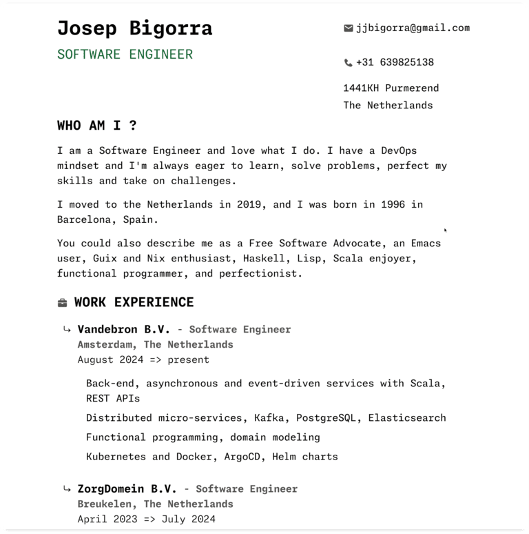

#+title: Iter Vitae
#+options: num:nil toc:nil

Iter Vitae is a free software project that aims to make it easy and maintainable to generate an attractive, modern and customizable /Curriculum Vitae/ or /resume/ for yourself and to allow you to define the course of your life and career directly in Guile Scheme code.

** The Manifesto

Everyone has the right to create a professional-looking Curriculum Vitae, using free software, without the constraints of proprietary software, lengthy setup processes, or a lack of freedom to modify layouts.

Traditional word processors like Word or LibreOffice can be cumbersome when trying to create a custom CV.

Iter Vitae offers an alternative by embracing the spirit of hacking and freedom, enabling you to customize every aspect of your CV.

With this tool, you can define the content, layout, and presentation of your CV directly in code, making it highly flexible and maintainable.

The tool separates data from its presentation (following the principles of the Model-View-Controller or MVC architecture), so you can focus on the data itself without worrying about formatting or styling.

*** Build a Curriculum Vitae for your next 40 years

This tool isn't just about creating a one-off CV — it's designed for long-term use, so you can update and evolve your resume over the years. The software supports multilingual content and is fully extensible, allowing you to add new data entries, customize the design, and even support additional languages.

Version-control your CV code, and enjoy all the benefits.

Work with a sane and flexible multi-lingual compatible data model. The tool is extensible and supports an arbitrary amount of languages, data entries.

Remember that with Guile Scheme, and the Lisp super-powers, everything is hackable and modifyable at any moment, giving you ultimate control and power.

** Showcase

You can see an example of the most up-to-date version of my CV generated with Iter Vitae by visiting my website:

[[https://jointhefreeworld.org/cv/][https://jointhefreeworld.org/cv/]]

Alternatively, download a sample PDF of my generated /Curriculum Vitae/, whcih could potentially be a bit more outdated:

[[file:resources/pdf/Iter Vitae.pdf][Iter Vitae.pdf]]

This sample demonstrates the capabilities of the tool in generating clean, readable, and professional-looking resumes.

** Running

For detailed instructions on building and running the tool, refer to the Makefile.

The only dependencies currently are Guile Scheme (3.0 or newer), the built-in SXML library, and GNU Make.

More flexible and configurable running mechanisms are in the making, but for now some helpers are defined like ~make persona-joe-en~.

In order to view the output this tool generates, we recommend you use a free web browser such as GNU IceCat, and after running the tool, open the file at ~./dist/index.html~ or alternately upload and serve it from the web server of your choice.

-----

** Project Management

*** ⚙️ Work in Progress

**** WIP add spoken/read/written language proficiency table, and allow also a simple version of language proficiency when people simply wanna list 1/2 langs.

*** 📓 Backlog

**** TODO submit project to the GNU project.

**** TODO make directories configurable so that iter-vitae can be installed to a system, and read personas from any directory the user wants.

**** TODO implement ef-cyprus, ef-bio and other color schemes

**** TODO implement support for other font types

**** TODO create CLI wizard that will automatically generate a simple Guile Scheme code "persona" for a user configuration.

**** TODO create Guix channel for "trunk" branch, and submit project to Guix packages.

*** ✅ Work done

**** DONE get a proof-of-concept good looking theme shipped and gather feedback
CLOSED: [2024-12-18 wo 22:25]

**** DONE define a sane and flexible data model for personas
CLOSED: [2024-12-18 wo 22:25]
