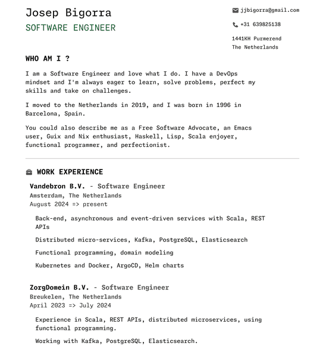
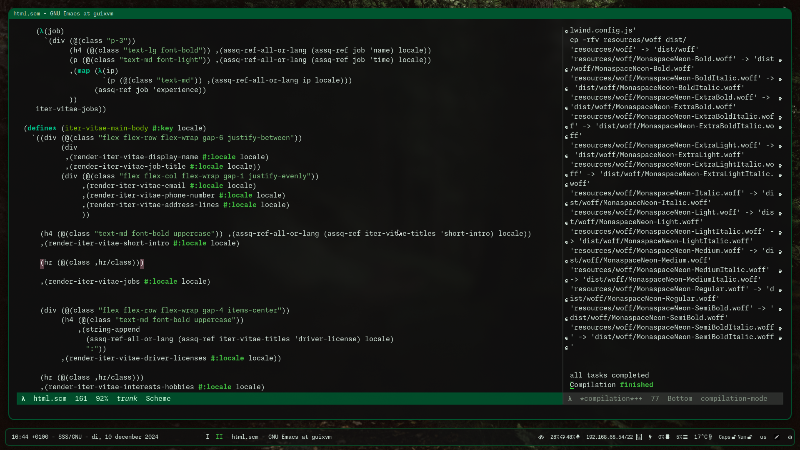

#+title: Iter Vitae

Iter Vitae is a free software project that aims to make it easy and maintainable to generate an attractive, modern and customizable /Curriculum Vitae/ or /resume/ for yourself and to allow you to define the course of your life and career directly in Guile Scheme code.

🐉 caution: here be dragons, project in early phases, but fully committed to developing further.

** The Manifesto

Everyone has the right to create a professional-looking Curriculum Vitae without the constraints of proprietary tools, lengthy setup processes, or a lack of freedom to modify layouts. Traditional word processors like Word or LibreOffice can be cumbersome when trying to create a custom CV. Iter Vitae offers an alternative by embracing the spirit of hacking and freedom, enabling you to customize every aspect of your CV.

With Iter Vitae, you can define the content, layout, and presentation of your CV directly in code, making it highly flexible and maintainable. The tool separates data from its presentation (following the principles of the Model-View-Controller or MVC architecture), so you can focus on the data itself without worrying about formatting or styling.

With this tool you can build your resume for your next 40 years, and de-couple the data from the presentation layer, a la MVC.

This tool isn't just about creating a one-off CV — it's designed for long-term use, so you can update and evolve your resume over the years. The software supports multilingual content and is fully extensible, allowing you to add new data entries, customize the design, and even support additional languages.

Work with a sane and flexible multi-lingual compatible data model. The tool is extensible and supports an arbitrary amount of languages, data entries.

Coming soon: Customizable Layouts - Modify every detail of your CV, from fonts to layout, ensuring it matches your personal style or professional standards.

Hacker-Friendly: Built with freedom and flexibility in mind, it enables you to work with code directly and make interactive adjustments.

Data-Driven: Decouple your career data from its presentation, making it easier to manage and update over time.

Multilingual Support: Create CVs in multiple languages, with support for defining language-specific content.

Extensible: Easily add new data types, sections, or features to suit your needs.

** Showcase

You can see an example of the most up-to-date version of my CV generated with Iter Vitae by visiting my website:

[[https://jointhefreeworld.org/cv/][https://jointhefreeworld.org/cv/]]

Alternatively, download a sample PDF of my generated /Curriculum Vitae/, whcih could potentially be a bit more outdated:

[[file:resources/pdf/Iter Vitae.pdf][Iter Vitae.pdf]]

This sample demonstrates the capabilities of the tool in generating clean, readable, and professional-looking resumes.

** Running

For detailed instructions on building and running the tool, refer to the Makefile.

The only dependencies currently are Guile and make.

For now some helpers are defined like ~make persona-joe-en~.

** Bonus: Hacking with Emacs

Want to see how I like to hack on this project? Here's an image showing my Emacs setup as I work on Iter Vitae:

The development of Iter Vitae is optimized for the use of Emacs, providing a fast, efficient environment for editing and testing Guile Scheme code. If you're a fellow Emacs user, you’ll feel right at home.

